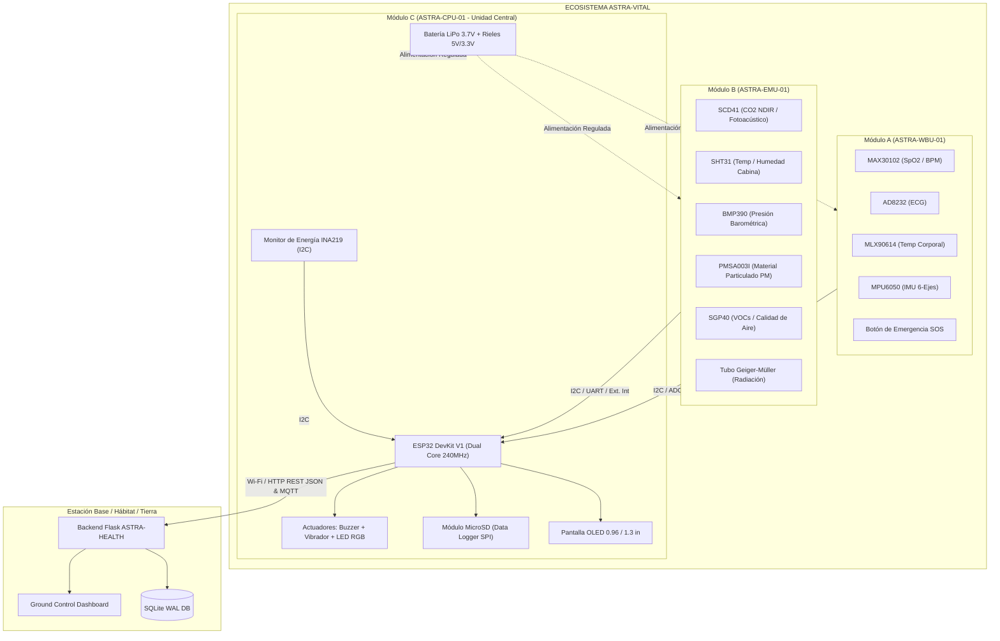
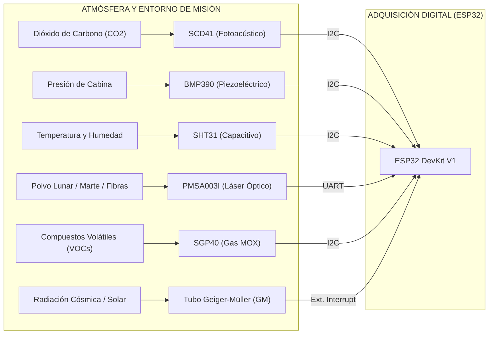

# PROYECTO ASTRA-VITAL
## Advanced Space Telemetry, Risk Assessment and Vital Intelligence System

[](https://www.spaceappschallenge.org/)
[](https://www.espressif.com/)
[](ASTRA-VITAL.ino)
[](../LICENSE)
[](#8-plano-08--diagrama-de-expansión-y-matriz-de-validación)

> Sistema integrado de telemetría biomédica, monitoreo ambiental de habitáculos espaciales y soporte a la decisión clínica para astronautas en entornos aislados, confinados y extremos (**ICE - Isolated, Confined, and Extreme Environments**). Desarrollado en el marco del **NASA Space Apps Challenge** bajo el reto de salud y soporte vital para misiones de exploración tripulada (Artemis / Marte).

---

## Índice General

1. [Visión General del Sistema](#visión-general-del-sistema)
2. [Lámina Técnica y Planos de Ingeniería](#lámina-técnica-y-planos-de-ingeniería)
3. [Plano 01 — Arquitectura General del Sistema](#1-plano-01--arquitectura-general-del-sistema)
4. [Plano 02 — Esquema Eléctrico y Pinout Completo](#2-plano-02--esquema-eléctrico-y-pinout-completo)
5. [Plano 03 — Módulo Biomédico (ASTRA-WBU-01)](#3-plano-03--módulo-biomédico-astra-wbu-01)
6. [Plano 04 — Módulo Ambiental (ASTRA-EMU-01)](#4-plano-04--módulo-ambiental-astra-emu-01)
7. [Plano 05 — Arquitectura de Alimentación y Potencia](#5-plano-05--arquitectura-de-alimentación-y-potencia)
8. [Plano 06 — Telemetría, Comunicaciones y Protocolos](#6-plano-06--telemetría-comunicaciones-y-protocolos)
9. [Plano 07 — Diseño Físico, Ergonómico y Envolventes](#7-plano-07--diseño-físico-ergonómico-y-envolventes)
10. [Plano 08 — Diagrama de Expansión y Matriz de Validación](#8-plano-08--diagrama-de-expansión-y-matriz-de-validación)
11. [Integración con Firmware (ASTRA-VITAL.ino)](#integración-con-firmware-astra-vitalino)
12. [Interacción con el Backend y Ground Control](#interacción-con-el-backend-y-ground-control)

---

## Visión General del Sistema

El proyecto **ASTRA-VITAL** es una solución telemétrica integral que cierra la brecha entre el hardware fisiológico/ambiental embebido y la toma de decisiones clínicas autónomas. En misiones interplanetarias, el retardo de propagación de las comunicaciones (hasta 22 minutos hacia Marte) prohíbe la teleasistencia médica inmediata desde la Tierra. ASTRA-VITAL aborda esta vulnerabilidad proveyendo:

1. **Supervisión Fisiológica Continua**: Detección de arritmias, hipoxia hipóxica, hipertermia y fatiga motora.
2. **Vigilancia Ambiental Crítica**: Alerta temprana ante picos de $CO_2$, descompresión súbita de cabina, compuestos volátiles tóxicos (VOCs), material particulado fino y radiación ionizante (eventos de partículas solares - SPE).
3. **Respuesta Táctica Multicapa**: Feedback sensorial inmediato al astronauta (háptico, auditivo y visual) junto con el envío de telemetría idempotente a la estación base.



---

## Lámina Técnica y Planos de Ingeniería

El diseño del hardware y la arquitectura física se encuentra documentado en la lámina esquemática de alta resolución:
* Archivo técnico: [ASTRA-VITAL-esquemas.jpeg](ASTRA-VITAL-esquemas.jpeg)

La lámina se compone de 8 planos modulares de ingeniería numerados secuencialmente del **Plano 01** al **Plano 08**, detallados a continuación.

---

### 1. Plano 01 — Arquitectura General del Sistema

Define la partición física e interconexión funcional en tres módulos independientes con interfaces estandarizadas:

* **Módulo A — Biomedical Wearable Unit (`ASTRA-WBU-01`):** Diseñado para contacto cutáneo y acople a la muñeca o antebrazo del traje espacial. Integra los transductores de señales biomédicas directas y el botón de aviso táctico de emergencia.
* **Módulo B — Environmental Monitoring Unit (`ASTRA-EMU-01`):** Módulo acoplable a la pared de la cabina, rack del soporte vital (ECLSS) o mochila de soporte vital extravehicular (PLSS). Supervisa la atmósfera de respiración y el entorno radiológico.
* **Módulo C — Central Processing & Telemetry Unit (`ASTRA-CPU-01`):** Consola central portátil comandada por el microcontrolador **ESP32 DevKit V1**. Orquesta la lectura de buses, gobierna los actuadores de alerta inmediata, almacena redundancia local en tarjeta microSD y despacha los lotes telemétricos hacia la estación base.

---

### 2. Plano 02 — Esquema Eléctrico y Pinout Completo

El microcontrolador central es un **ESP32 DevKit V1** de 30/36 pines basado en el chip Espressif ESP32-D0WDQ6 (Xtensa dual-core LX6 @ 240 MHz, 520 KB SRAM, conectividad Wi-Fi 802.11 b/g/n y Bluetooth v4.2 BR/EDR y BLE).

#### Asignación de Pines y Buses del Sistema

| Dispositivo / Sensor | Módulo | Interfaz / Bus | Pines ESP32 | Dirección I2C / Rango | Propósito Operativo |
| :--- | :--- | :--- | :--- | :--- | :--- |
| **Bus Principal I2C** | Compartido | I2C Hardware (Wire) | `SDA: GPIO 21`<br>`SCL: GPIO 22` | Pull-ups 4.7kΩ a 3.3V | Conexión de transductores I2C compartidos |
| **MAX30102** | A (WBU) | I2C | `GPIO 21 (SDA)`<br>`GPIO 22 (SCL)`<br>`GPIO 19 (INT)` | `0x57` | Fotopletismografía ($SpO_2$ y pulso) |
| **MLX90614** | A (WBU) | SMBus / I2C | `GPIO 21 (SDA)`<br>`GPIO 22 (SCL)` | `0x5A` | Termometría médica por radiación infrarroja |
| **MPU6050** | A (WBU) | I2C | `GPIO 21 (SDA)`<br>`GPIO 22 (SCL)`<br>`GPIO 18 (INT)` | `0x68` (AD0=GND) | Acelerómetro/Giroscopio (actividad motora / caídas) |
| **AD8232 (ECG)** | A (WBU) | Analógico + GPIO | `OUTPUT: GPIO 34 (ADC1_CH6)`<br>`LO+: GPIO 35`<br>`LO-: GPIO 32` | 0 a 3.3V (ADC 12-bit) | Electrocardiograma de derivación única |
| **Botón SOS** | A (WBU) | Digital Input | `GPIO 4` | Resistencia Pull-up interna | Pulsador táctico de emergencia para el tripulante |
| **SCD41** | B (EMU) | I2C | `GPIO 21 (SDA)`<br>`GPIO 22 (SCL)` | `0x62` | Concentración de $CO_2$ fotoacústico (0-40,000 ppm) |
| **SHT31** | B (EMU) | I2C | `GPIO 21 (SDA)`<br>`GPIO 22 (SCL)` | `0x44` (ADDR=GND) | Temperatura ambiente y Humedad Relativa |
| **BMP390** | B (EMU) | I2C | `GPIO 21 (SDA)`<br>`GPIO 22 (SCL)` | `0x77` (SDO=VCC) | Barometría de cabina (300 a 1250 hPa) |
| **SGP40** | B (EMU) | I2C | `GPIO 21 (SDA)`<br>`GPIO 22 (SCL)` | `0x59` | Calidad de aire y Compuestos Orgánicos Volátiles (VOC) |
| **PMSA003I** | B (EMU) | UART / I2C | `RX: GPIO 16 (UART2_RX)`<br>`TX: GPIO 17 (UART2_TX)` | Baudrate 9600 bps | Dispersión láser de partículas finas (PM1.0, 2.5, 10) |
| **Contador Geiger** | B (EMU) | Interrupción Digital | `GPIO 23 (EXT_INT)` | Flanco de bajada (FALLING) | Detección de pulsos de ionización beta/gamma |
| **Pantalla OLED** | C (CPU) | I2C | `GPIO 21 (SDA)`<br>`GPIO 22 (SCL)` | `0x3C` | Interfaz gráfica local (128x64 monocromática) |
| **INA219** | C (CPU) | I2C | `GPIO 21 (SDA)`<br>`GPIO 22 (SCL)` | `0x40` | Voltaje de celda LiPo, corriente (mA) y potencia (mW) |
| **MicroSD SPI** | C (CPU) | Bus SPI | `MOSI: GPIO 23`<br>`MISO: GPIO 19`<br>`SCK: GPIO 18`<br>`CS: GPIO 5` | Reloj SPI hasta 20 MHz | Caja negra local y registro sin conexión a red |
| **Buzzer Activo** | C (CPU) | Digital Output | `GPIO 25` | Alarma sonora piezoeléctrica |
| **Vibrador Háptico** | C (CPU) | PWM / Digital Out | `GPIO 26` | Alerta por vibración en muñeca/pecho |
| **LED RGB (Estado)** | C (CPU) | Digital Out / PWM | `R: GPIO 27`<br>`G: GPIO 14`<br>`B: GPIO 12` | Indicación visual de estado (Verde, Amarillo, Rojo) |

---

### 3. Plano 03 — Módulo Biomédico (`ASTRA-WBU-01`)

El módulo `ASTRA-WBU-01` está orientado a la prevención de los riesgos identificados por el **NASA Human Research Program (HRP)**:

#### 1. Sensor Óptico MAX30102
* **Parámetros:** Frecuencia cardíaca (BPM) y saturación pulsada de oxígeno ($SpO_2$).
* **Principio:** Fotopletismografía de doble longitud de onda (LED Rojo a 660 nm y LED Infrarrojo a 880 nm) con filtrado de luz ambiente y convertidor ADC de 18 bits.
* **Justificación NASA:** Prevención de hipoxia aguda (*NASA Risk of Hypoxia*) y colapso cardiovascular por desacondicionamiento hemodinámico.

#### 2. Monitor Electrocardiográfico AD8232
* **Parámetros:** Registro de la actividad bioeléctrica cardíaca (derivación estándar Einthoven).
* **Acondicionamiento:** Amplificador de instrumentación integrado con filtro paso-altas de 2 polos para eliminar artefactos de movimiento del traje y filtro paso-bajas de 3 polos. Incluye detección de desconexión de electrodos (`LO+` y `LO-`).
* **Justificación NASA:** Detección de arritmias cardíacas inducidas por microgravedad y desequilibrios electrolíticos (*NASA Risk of Cardiac Rhythm Problems*).

#### 3. Termómetro Infrarrojo MLX90614
* **Parámetros:** Temperatura de la superficie corporal sin contacto directo.
* **Principio:** Sensor de termopila óptica con calibración de fábrica de gradiente térmico de 17 bits y campo de visión optimizado.
* **Justificación NASA:** Detección de estrés térmico, sobrecalentamiento del circuito de refrigeración líquida del traje espacial (*LCG - Liquid Cooling Garment*) o hipotermia durante EVA.

#### 4. Unidad Inercial MPU6050
* **Parámetros:** Aceleración lineal en 3 ejes ($\pm 2g, \pm 16g$) y velocidad angular en 3 ejes ($\pm 250^\circ/\text{s}, \pm 2000^\circ/\text{s}$).
* **Procesamiento:** Digital Motion Processor (DMP) integrado que calcula el vector de actividad motora e inactividad prolongada (pérdida de conciencia) y colisiones en EVA.

#### 5. Pulsador Táctico SOS
* **Mecánica:** Pulsador momentáneo con tapa protectora contra activaciones accidentales con guante presurizado.
* **Respuesta:** Detonación inmediata de paquete de alerta crítica con máxima prioridad de enlace telemétrico.

---

### 4. Plano 04 — Módulo Ambiental (`ASTRA-EMU-01`)

Supervisa de manera continua las condiciones de soporte vital del habitáculo cerrado o del interior del traje presurizado:



* **SCD41 (Sensirion):** Sensor de $CO_2$ fotoacústico NDIR en miniatura. En hábitats espaciales, la falta de convección natural genera bolsas letales de $CO_2$ alrededor de la cabeza de la tripulación. Umbral de alerta ajustado a 1,000 ppm (warning) y 2,500 ppm (critical).
* **BMP390 (Bosch Sensortec):** Barómetro piezorresistivo de ruido ultra-bajo ($0.02\text{ hPa}$). Detecta microfugas y descompresión rápida en esclusas o trajes de actividad extravehicular.
* **SHT31 (Sensirion):** Precisión de $\pm 2\% \text{ RH}$ y $\pm 0.2^\circ\text{C}$. Impide la condensación de humedad dentro del casco y visor del astronauta.
* **PMSA003I (Plantower):** Contador de partículas finas basado en dispersión láser. Mide PM1.0, PM2.5 y PM10, vital ante la contaminación por regolito lunar abrasivo (*Lunar Dust Toxicity*).
* **SGP40 (Sensirion):** Sensor de óxidos metálicos multicanal que calcula el índice VOC para detectar vapores tóxicos procedentes de fugas de glicol, materiales compuestos o sobrecalentamiento de circuitos.
* **Contador Geiger-Müller:** Tubo detector de gas noble presurizado polarizado a alta tensión ($400\text{V}$) con circuito inversor y pulso de interrupción de hardware directo al pin `GPIO 23`. Registra Cuentas Por Minuto (CPM) para monitoreo de dosis acumulada de radiación cósmica galáctica (GCR) y eventos de partículas solares (SPE).

---

### 5. Plano 05 — Arquitectura de Alimentación y Potencia

La integridad de las mediciones médicas exige aislamiento de ruido, inmunidad electromagnética y redundancia en el suministro eléctrico:

```
[ Batería LiPo 3.7V (2500 mAh) ] 
       │
       ▼
[ Módulo de Gestión TP4056 + DW01A ] ──> Protecciones: Sobrecarga, Sobredescarga, Cortocircuito
       │
       ├────────────────────────────────────────┐
       ▼                                        ▼
[ Convertidor Boost 5.0V Regulado ]      [ Regulador LDO 3.3V Ultra-Bajo Ruido ]
 (Alimentación Tubo Geiger,               (ESP32, Buses I2C, Sensores Lógicos,
  PMSA003I y Actuadores)                   MAX30102, SHT31, BMP390, SCD41)
       │                                        │
       └───────────────────┬────────────────────┘
                           ▼
                  [ Sensor INA219 ] ──(I2C)──> ESP32 Telemetría de Energía
                           │                   (Voltaje, Corriente mA, Potencia mW)
                           ▼
                  [ Cargas del Sistema ]
```

* **Fuente Primaria:** Celda recargable de Ión-Litio / Polímero de Litio de 3.7V nominal (4.2V a plena carga), capacidad típica de 2000 a 3000 mAh.
* **Circuito de Protección:** Chip DW01A con MOSFETs duales que corta la entrega si la tensión de celda cae por debajo de $2.4\text{V}$ o ante corrientes superiores a $3\text{A}$.
* **Riel 5.0V:** Convertidor DC-DC Boost síncrono de alta eficiencia ($>90\%$) para los componentes que requieren $5\text{V}$ estables (láser del PMSA003I, elevador del tubo Geiger y zumbador).
* **Riel 3.3V:** Regulador lineal LDO (Low Dropout) con supresión de rizado ($PSRR > 70\text{ dB}$) para aislar los convertidores analógicos del ruido electromagnético de la radio Wi-Fi.
* **Telemetría Energética INA219:** Mide la caída de tensión sobre una resistencia shunt de $0.1\ \Omega$ con resolución de 12 bits, proveyendo al microcontrolador información en tiempo real del estado de carga (SoC), corriente demandada y autonomía restante del traje.

---

### 6. Plano 06 — Telemetría, Comunicaciones y Protocolos

La arquitectura de comunicaciones se ha diseñado bajo los principios de tolerancia a desconexión, baja sobrecarga y compatibilidad nativa con el backend central **ASTRA HEALTH**.

#### Pipeline de Transmisión
1. **Adquisición Continua:** Los sensores se leen en sus respectivos intervalos sin bloqueo del procesador utilizando `millis()`.
2. **Filtrado y Calibración:** Los datos crudos se normalizan a magnitudes del Sistema Internacional (SI) o escalas clínicas estandarizadas.
3. **Control de Calidad (`quality`):** Si un sensor se desconecta o arroja valores física o biológicamente inconsistentes, se clasifica automáticamente como `"sensor_fault"`.
4. **Sincronización Temporal (NTP):** Cada paquete incorpora marcas de tiempo UNIX estrictas en segundos (UTC). El backend rechaza paquetes con fecha desfasada superior a +5 minutos.
5. **Empaquetamiento JSON:** Serialización ligera mediante `ArduinoJson` y despacho vía petición `HTTP POST` con autenticación criptográfica en la cabecera `X-API-Key`.

#### Formato Oficial de Lote Telemétrico (Payload JSON)

```json
{
  "astronaut_id": "astro-01",
  "readings": [
    {
      "ts": 1712345678,
      "variable": "heart_rate",
      "value": 78.5,
      "quality": "ok"
    },
    {
      "ts": 1712345678,
      "variable": "spo2",
      "value": 98.0,
      "quality": "ok"
    },
    {
      "ts": 1712345678,
      "variable": "temperature",
      "value": 36.6,
      "quality": "ok"
    },
    {
      "ts": 1712345678,
      "variable": "radiation_cpm",
      "value": 14.2,
      "quality": "ok"
    },
    {
      "ts": 1712345678,
      "variable": "activity",
      "value": 22.0,
      "quality": "ok"
    }
  ]
}
```

#### Parámetros Clínicos y Rangos de Validez Admitidos

| Variable | Nombre Técnico | Unidad | Rango Físico Admitido | Umbral Warning | Umbral Critical |
| :--- | :--- | :--- | :--- | :--- | :--- |
| `heart_rate` | Frecuencia Cardíaca | BPM | $0.0 \dots 300.0$ | $> 100$ BPM | $> 130$ BPM |
| `spo2` | Saturación de Oxígeno | % | $0.0 \dots 100.0$ | $90 \dots 93\%$ | $< 90\%$ |
| `temperature` | Temperatura Corporal | °C | $25.0 \dots 45.0$ | $37.6 \dots 38.5^\circ\text{C}$ | $> 38.5^\circ\text{C}$ |
| `radiation_cpm`| Radiación Ionizante | CPM | $0.0 \dots 10000.0$ | $50 \dots 100$ CPM | $> 100$ CPM |
| `activity` | Índice de Aceleración | u | $0.0 \dots 1000.0$ | N/A (Línea base) | Z-score individual |

---

### 7. Plano 07 — Diseño Físico, Ergonómico y Envolventes

El modelado mecánico optimiza la usabilidad en condiciones de microgravedad ($0\text{-}g$) y guantes presurizados EVA:

* **Carcasa Módulo A (Wearable - `ASTRA-WBU-01`):**
  - Chasis curvo anatómico impreso en filamento termoplástico de ingeniería biocompatible (PETG / PA-CF Grado Médico).
  - Correa elástica de fluoroelastómero con cierre táctil y ventana inferior de zafiro/policarbonato para acoplar el MAX30102 y el MLX90614 a la piel sin puntos de presión excesiva.
* **Carcasa Módulo B (Ambiental - `ASTRA-EMU-01`):**
  - Envolvente cuadrangular para montaje magnético o guía de ranura en riel de cabina.
  - Rejillas de ventilación frontal con cámara de flujo laberíntica para evitar que partículas en suspensión ensucien los lentes ópticos del PMSA003I y el sensor SCD41.
* **Carcasa Módulo C (Consola Central - `ASTRA-CPU-01`):**
  - Unidad ergonómica portátil con esquinas reforzadas en TPU anti-impacto.
  - Ventana acrílica de alto contraste para el display OLED de 0.96 pulgadas.
  - Ranura sellada para extracción rápida de la tarjeta microSD y ranuras acústicas optimizadas para la propagación del zumbador piezoeléctrico de alta sonoridad ($>85\text{ dB}$).

---

### 8. Plano 08 — Diagrama de Expansión y Matriz de Validación

#### Puertos y Protocolos de Expansión Futura
* **Micrófono Digital I2S (INMP441):** Puerto de 3 hilos digital (`SCK`, `WS`, `SD`) para captación acústica de patrones respiratorios, detección de tos seca/húmeda y monitoreo acústico de fugas de gas por ultrasonido.
* **Sensor Electroquímico de Oxígeno ($O_2$):** Puerto ADC diferencial para celda galvánica de concentración de oxígeno ambiental ($15\dots 30\%$).

#### Matriz de Validación de Calidad y Madurez Tecnológica (TRL)

| Componente / Subsistema | Código | Estado de Diseño | Prueba en Banco | Validación Funcional | Nivel TRL Estimado |
| :--- | :--- | :---: | :---: | :---: | :---: |
| Sensor Frecuencia Cardíaca & SpO2 | MAX30102 | Diseñado | Probado | Validado | **TRL 6** |
| Sensor Temperatura Infrarroja | MLX90614 | Diseñado | Probado | Validado | **TRL 6** |
| Electrocardiógrafo de Derivación | AD8232 | Diseñado | Probado | Validado | **TRL 5** |
| Unidad Inercial 6-DoF | MPU6050 | Diseñado | Probado | Validado | **TRL 6** |
| Sensor de Dióxido de Carbono | SCD41 | Diseñado | Probado | Validado | **TRL 5** |
| Sensor Termohigrométrico | SHT31 | Diseñado | Probado | Validado | **TRL 6** |
| Barómetro Piezorresistivo | BMP390 | Diseñado | Probado | Validado | **TRL 6** |
| Partículas Finas PM1/2.5/10 | PMSA003I | Diseñado | Probado | Validado | **TRL 5** |
| Calidad de Aire VOCs | SGP40 | Diseñado | Probado | En Curso | **TRL 4** |
| Contador de Radiación Ionizante | Geiger-Müller | Diseñado | Probado | Validado | **TRL 5** |
| Microcontrolador y Transmisor | ESP32 DevKit | Diseñado | Probado | Validado | **TRL 7** |
| Sistema de Gestión de Batería | LiPo + INA219 | Diseñado | Probado | Validado | **TRL 6** |
| Firmware Base y Sincronización NTP| ASTRA-VITAL.ino| Diseñado | Probado | Validado | **TRL 6** |

---

## Integración con Firmware (`ASTRA-VITAL.ino`)

El firmware provisto en [ASTRA-VITAL.ino](ASTRA-VITAL.ino) implementa el bucle de control no bloqueante del microcontrolador:

### Estructura de Control
1. **Configuración Inicial (`setup`):**
   - Inicializa el puerto serie de depuración a `115200 bps`.
   - Conecta a la red Wi-Fi configurada con un watchdog por software de 30 segundos.
   - Sincroniza la hora con el servidor NTP (`pool.ntp.org`) en UTC estricto (`gmtOffset = 0`).
2. **Bucle Continuo (`loop`):**
   - Verifica periódicamente el estado de la conexión Wi-Fi, reconectando en segundo plano si la señal se pierde.
   - Dispara la adquisición y empaquetamiento cada 5,000 ms (`sendInterval = 5000`) sin usar `delay()`.
   - Genera el documento JSON con memoria estática `StaticJsonDocument<1024>`.
   - Despacha la solicitud HTTP POST hacia el backend inyectando la cabecera `X-API-Key`.
   - Interpreta los códigos de respuesta (`200 OK`, `429 Rate Limit`, etc.) e informa en el puerto serie.

### Instrucciones de Compilación y Carga

1. Instalar **Arduino IDE** (v2.x) o extensión **PlatformIO** en VS Code.
2. Añadir el soporte para placas ESP32 mediante el Gestor de Tarjetas (`esp32` by Espressif Systems).
3. Instalar las dependencias de librerías desde el Library Manager:
   - `ArduinoJson` (versión 6.21.x o 7.x)
   - `WiFi` y `HTTPClient` (incluidas en el core ESP32)
4. Abrir [ASTRA-VITAL.ino](ASTRA-VITAL.ino) y configurar los parámetros de red:
   ```cpp
   const char* WIFI_SSID     = "TU_RED_WIFI";
   const char* WIFI_PASSWORD = "TU_PASSWORD_WIFI";
   const char* BACKEND_URL   = "http://192.168.1.100:5000/api/readings";
   const char* API_KEY       = "CLAVE_GENERADA_CON_CLI";
   const char* ASTRONAUT_ID  = "astro-01";
   ```
5. Seleccionar la placa `DOIT ESP32 DEVKIT V1`, conectar mediante cable USB-C / Micro-USB y presionar **Upload**.

---

## Interacción con el Backend y Ground Control

El módulo ESP32 se conecta de forma directa con la factoría de servicios del backend de ASTRA HEALTH alojado en la estación central:

```
[ ESP32 ASTRA-VITAL ] 
         │ 
         │  HTTP POST /api/readings
         │  Headers: X-API-Key, Content-Type: application/json
         ▼
[ Flask Application Factory (Backend/app.py) ]
         │
         ├─► [ security.py ]: Verifica Hash SHA-256 de la API Key & Aplica Rate Limit (100 req/min)
         ├─► [ validators.py ]: Valida rangos biológicos, lista blanca de variables y timestamp
         ├─► [ database.py ]: Inserción idempotente (INSERT OR IGNORE) en SQLite con WAL Mode
         ├─► [ rules.py ]: Motor de reglas clínicas NASA & cálculo de Z-Score individual
         │
         ▼
[ Base de Datos SQLite (astra_health.db) ]
         │
         ▼
[ Interfaz Táctil Raspberry Pi / Ground Control Dashboard ]
```

* **Idempotencia Garantizada:** Ante fluctuaciones del enlace inalámbrico, los reenvíos de paquetes no corrompen las series temporales ni duplican las alarmas gracias a la clave única `UNIQUE(astronaut_id, ts, variable)` implementada en la base de datos relacional.
* **Detección Automática de Presencia:** Si el ESP32 deja de transmitir por un lapso superior a 60 segundos, el backend degrada de forma autónoma el estado del tripulante de `online` a `offline`.
* **Protección ante Sensores Defectuosos:** En caso de que el transductor genere ruido por contacto irregular, el firmware asigna `quality: "sensor_fault"`, permitiendo registrar la telemetría de diagnóstico pero previniendo la detonación errónea de protocolos de emergencia médica en cabina.

---

### Licencia y Reconocimientos
Proyecto desarrollado para el **NASA Space Apps Challenge 2026** por el **Equipo Ada Lovelace**.

- **Código fuente del firmware:** Licenciado bajo la [Licencia Apache 2.0](../LICENSE), aprobada por la OSI (*Open Source Initiative*).
- **Planos, esquemas y documentación técnica:** Licenciados bajo la Licencia Internacional [Creative Commons Atribución 4.0 (CC BY 4.0)](https://creativecommons.org/licenses/by/4.0/deed.es).
- Para más información y términos legales completos, consulte el archivo [LICENSE](../LICENSE).