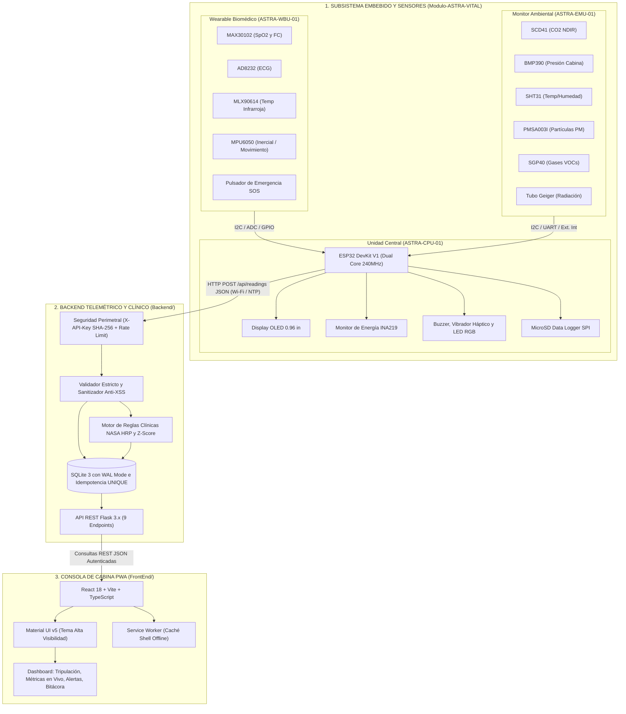

# Astro-vital / ASTRA-VITAL
## Advanced Space Telemetry, Risk Assessment and Vital Intelligence System

[](https://www.spaceappschallenge.org/)
[](LICENSE)
[](https://opensource.org/licenses/Apache-2.0)
[](LICENSE)
[](docs/MVP_SCOPE.md)

> **Proyecto desarrollado por el Equipo Ada Lovelace para el NASA Space Apps Challenge 2026** bajo el desafío de salud y soporte vital para tripulaciones en misiones de exploración espacial profunda y hábitats en entornos aislados, confinados y extremos (**ICE - Isolated, Confined, and Extreme Environments**).

---

## Índice General

1. [Visión y Planteamiento del Reto](#visión-y-planteamiento-del-reto)
2. [Arquitectura Integral del Sistema](#arquitectura-integral-del-sistema)
3. [Estructura del Repositorio y Componentes](#estructura-del-repositorio-y-componentes)
4. [Subsistemas del Proyecto](#subsistemas-del-proyecto)
   - [Módulo Hardware Embebido: ASTRA-VITAL](#1-hardware-y-firmware-embebido-modulo-astra-vital)
   - [Backend Telemétrico y Motor Clínico](#2-backend-telemétrico-y-reglas-clínicas-backend)
   - [Frontend PWA y Consola de Cabina](#3-frontend-pwa-y-consola-de-cabina-frontend)
5. [Guía de Puesta en Marcha Rápida](#guía-de-puesta-en-marcha-rápida)
6. [Gobernanza, Roles y Políticas Médicas](#gobernanza-roles-y-políticas-médicas)
7. [Licencia de Código Abierto (NASA Space Apps)](#licencia-de-código-abierto-nasa-space-apps)

---

## Visión y Planteamiento del Reto

En misiones tripuladas hacia la Luna (Programa Artemis) y Marte, los astronautas se enfrentan a microgravedad prolongada, radiación cósmica galáctica (GCR), atmósferas confinadas y distancias que introducen **latencias de comunicación de hasta 22 minutos con la Tierra**. Esta realidad prohíbe el soporte médico en tiempo real desde el Centro de Control de Misión (MCC) de la NASA, exigiendo sistemas autónomos de supervisión telemétrica y soporte táctico a la decisión clínica.

**Astro-vital** resuelve este desafío mediante un ecosistema integral de tres capas:
1. **Adquisición Fisiológica y Ambiental Continua:** Monitoreo biomédico del astronauta (ritmo cardíaco, $SpO_2$, ECG, temperatura, aceleración) y de la atmósfera de cabina ($CO_2$, presión barométrica, material particulado, VOCs y radiación ionizante).
2. **Evaluación Clínica en el Borde (*Edge Computing*):** Ingesta telemétrica idempotente con un motor de reglas que combina umbrales médicos absolutos (NASA HRP) y detección de anomalías basales personalizadas ($Z\text{-Score}$).
3. **Consola Táctica Accesible y Resiliente (PWA):** Interfaz para cabina o traje que discrimina entre caídas de red, latencia de sensores, degradación de hardware y emergencias fisiológicas genuinas.

---

## Arquitectura Integral del Sistema

El siguiente diagrama detalla el flujo de información de extremo a extremo, desde los transductores físicos hasta la consola de cabina y el puesto de control:



---

## Estructura del Repositorio y Componentes

El repositorio se encuentra organizado de forma modular, con fronteras de responsabilidad bien definidas:

```
Astro-vital/
├── LICENSE                     # Licencia Apache 2.0 (código) y CC BY 4.0 (documentación)
├── README.md                   # Documento maestro y presentación del proyecto
├── AGENTS.md                   # Normas y directivas operativas de los agentes
│
├── Modulo-ASTRA-VITAL/         # Hardware embebido, planos y firmware de sensores
│   ├── README.md               # Documentación técnica completa (Planos 01 al 08)
│   ├── ASTRA-VITAL-esquemas.jpeg # Lámina esquemática de ingeniería en alta resolución
│   └── ASTRA-VITAL.ino         # Firmware Arduino/C++ para ESP32 DevKit V1
│
├── Backend/                    # Servidor telemétrico, reglas clínicas y base de datos
│   ├── README.md               # Documentación y referencia de arquitectura del backend
│   ├── app.py                  # Factoría de la aplicación Flask
│   ├── config.py               # Gestión centralizada de configuración (.env)
│   ├── database.py             # Transacciones SQLite, conexión segura y reintentos
│   ├── schema.sql              # Esquema de base de datos relacional y datos iniciales
│   ├── security.py             # Autenticación X-API-Key, hashing y Rate Limiting
│   ├── validators.py           # Validaciones semánticas, rangos fisiológicos y anti-XSS
│   ├── rules.py                # Motor de reglas clínicas NASA y cálculo de línea base
│   ├── generate_api_key.py     # Utilidad CLI para generación de credenciales seguras
│   ├── routes/                 # Blueprints REST (readings, astronauts, alerts, notes)
│   ├── docs/                   # Documentación exhaustiva (API.md, SECURITY.md, etc.)
│   └── tests/                  # Suite de 18 pruebas automatizadas con pytest
│
├── FrontEnd/                   # Interfaz de cabina, PWA y dashboard interactivo
│   ├── README.md               # Documentación y guía de desarrollo del frontend
│   ├── package.json            # Dependencias del ecosistema React/Vite/MUI
│   ├── vite.config.ts          # Configuración del bundler y servidor de desarrollo
│   ├── src/                    # Código fuente TypeScript/React
│   │   ├── app/                # Layouts principales y temas
│   │   ├── components/         # Componentes transversales accesibles
│   │   ├── features/           # Funcionalidades de tripulación y alertas
│   │   ├── services/           # Clientes HTTP y adaptadores de API
│   │   └── pwa/                # Service workers y capacidades offline
│   └── docs/README.md          # Especificación técnica detallada de interfaz
│
├── docs/                       # Especificaciones, gobernanza y políticas compartidas
│   ├── README.md               # Índice general de documentación compartida
│   ├── PROJECT_CONTEXT.md      # Contexto, usuarios y glosario del proyecto
│   ├── ARCHITECTURE.md         # Arquitectura lógica y escenarios de degradación
│   ├── MVP_SCOPE.md            # Alcance estricto del MVP y criterios de aceptación
│   ├── DECISIONS.md            # Registro de decisiones de arquitectura (ADRs)
│   ├── INTEGRATION_GUIDELINES.md # Guía de contratos, tipos y normalización
│   ├── MEDICAL_CONTENT_POLICY.md # Política médica estricta y riesgos NASA HRP
│   └── roles/                  # Definición de funciones y propiedad de componentes
│
└── leader-workstream/          # Gestión de proyectos, planes y seguimiento de entregables
    ├── README.md               # Plan de trabajo general del líder de frontend
    ├── WORK_PLAN.md            # Hitos, cronograma y dependencias
    ├── deliverables/           # Fichas de especificación técnica (L01 a L09)
    └── reports/                # Informes de auditoría y avance técnico
```

---

## Subsistemas del Proyecto

### 1. Hardware y Firmware Embebido (`Modulo-ASTRA-VITAL`)
* **Lámina de Ingeniería:** Documentada en 8 planos de detalle en [Modulo-ASTRA-VITAL/README.md](Modulo-ASTRA-VITAL/README.md) a partir de [ASTRA-VITAL-esquemas.jpeg](Modulo-ASTRA-VITAL/ASTRA-VITAL-esquemas.jpeg).
* **Módulo A (Wearable - `ASTRA-WBU-01`):** Pulsera anatómica con MAX30102, electrocardiografía AD8232, termómetro infrarrojo MLX90614, acelerómetro MPU6050 y botón de socorro táctico.
* **Módulo B (Ambiental - `ASTRA-EMU-01`):** Monitor de habitáculo con SCD41 ($CO_2$), barómetro BMP390, sensor SHT31, contador de polvo fino PMSA003I, detector de VOCs SGP40 y contador Geiger para radiación cósmica y solar.
* **Módulo C (Unidad Central - `ASTRA-CPU-01`):** ESP32 con bus $I^2C$, display OLED, monitor de batería LiPo INA219, actuadores hápticos/acústicos y ranura microSD.
* **Firmware [ASTRA-VITAL.ino](Modulo-ASTRA-VITAL/ASTRA-VITAL.ino):** Adquisición no bloqueante con `millis()`, sincronización estricta por NTP en UTC, empaquetado `ArduinoJson` y envío HTTP seguro.

### 2. Backend Telemétrico y Reglas Clínicas (`Backend/`)
* **Framework:** Python 3.11+ con Flask 3.x, arquitectura modular por Blueprints.
* **Base de Datos:** SQLite 3 configurado con `PRAGMA journal_mode = WAL` para concurrencia de lectura/escritura y clave `UNIQUE(astronaut_id, ts, variable)` para garantizar **ingesta idempotente**.
* **Motor de Reglas Clínicas:** Alineado con el *NASA Human Research Program (HRP)*:
  - **Umbrales Absolutos:** Frecuencia cardíaca ($>130$ BPM crítico), $SpO_2$ ($<90\%$ crítico), temperatura ($>38.5^\circ\text{C}$ crítico) y radiación ($>100$ CPM crítico).
  - **Línea Base Estadística ($Z\text{-Score}$):** Detección de anomalías personalizadas ($z > 2$ advertencia, $z > 4$ crítico) tras consolidar un mínimo de 50 muestras basales.
* **Seguridad Perimetral:** Autenticación obligatoria mediante cabecera `X-API-Key` con tokens hasheados en SHA-256 (nunca en texto plano) y *Rate Limiter* en memoria (100 peticiones/min).

### 3. Frontend PWA y Consola de Cabina (`FrontEnd/`)
* **Stack Tecnológico:** React 18, Vite, TypeScript estricto y Material UI v5.
* **Resiliencia Operativa:** Manejo explícito de desconexión del sensor (`calidad: "sensor_fault"`), antigüedad de muestras y desconexión de red de la estación.
* **Diseño para Entornos Espaciales:** Esquema de color optimizado para visión nocturna y baja fatiga lumínica, navegación completa por teclado y legibilidad de alto contraste.

---

## Guía de Puesta en Marcha Rápida

Para ejecutar frontend, backend y simulador en contenedores, consulta [Docker Compose](docker/README.md).

### 1. Levantar el Backend (Servidor Central)
```bash
# Navegar a la carpeta del backend
cd Backend

# Crear y activar entorno virtual Python
python -m venv venv
# En Windows (PowerShell):
.\venv\Scripts\Activate.ps1
# En Linux/macOS:
source venv/bin/activate

# Instalar dependencias
pip install -r requirements.txt

# Configurar variables de entorno y generar API Key de prueba
copy .env.example .env
python generate_api_key.py --name "esp32-suit-01"

# Iniciar el servidor Flask (puerto por defecto: 5000)
python app.py
```

### 2. Ejecutar las Pruebas Automatizadas del Backend
```bash
python -m pytest -v
```
*(Valida 18 pruebas unitarias y de integración que cubren ingesta, reglas clínicas, idempotencia, rate limit y protección contra inyecciones SQL).*

### 3. Levantar la Consola Frontend (PWA)
```bash
# Navegar a la carpeta del frontend
cd FrontEnd

# Instalar dependencias de Node.js
npm install

# Iniciar servidor de desarrollo Vite
npm run dev
```
La consola estará disponible en `http://localhost:5173`.

### 4. Flashear o Simular el Microcontrolador ESP32
1. Abrir [Modulo-ASTRA-VITAL/ASTRA-VITAL.ino](Modulo-ASTRA-VITAL/ASTRA-VITAL.ino) en Arduino IDE o PlatformIO.
2. Configurar las credenciales Wi-Fi, la IP del servidor y la `API_KEY` generada en el paso 1.
3. Compilar y cargar en la placa **DOIT ESP32 DevKit V1**.

---

## Gobernanza, Roles y Políticas Médicas

El proyecto se rige por especificaciones rigurosas para garantizar la reproducibilidad y la seguridad clínica de la información:

- **Política de Contenido Médico:** Consulte [docs/MEDICAL_CONTENT_POLICY.md](docs/MEDICAL_CONTENT_POLICY.md). El prototipo es una herramienta de soporte a la decisión situacional y telemetría de ingeniería; **no constituye un dispositivo médico certificado para diagnóstico autónomo ni prescripción farmacológica**.
- **Contratos de Integración:** Definidos exhaustivamente en [docs/INTEGRATION_GUIDELINES.md](docs/INTEGRATION_GUIDELINES.md) y [Backend/docs/API.md](Backend/docs/API.md).
- **Alcance del MVP:** Límites y criterios de aceptación en [docs/MVP_SCOPE.md](docs/MVP_SCOPE.md).

---

## Licencia de Código Abierto (NASA Space Apps)

Este proyecto ha sido liberado bajo licencias de código abierto aprobadas por la **Open Source Initiative (OSI)** y directrices de ciencia abierta del **NASA Space Apps Challenge 2026**:

* **Software, Firmware y Código Fuente:** Licenciado bajo la **[Licencia Apache 2.0](LICENSE)** (*Apache License, Version 2.0*).
* **Documentación Técnica, Láminas de Ingeniería y Diseños:** Licenciados bajo la Licencia Internacional **[Creative Commons Atribución 4.0 (CC BY 4.0)](https://creativecommons.org/licenses/by/4.0/deed.es)**.

Consulte el archivo [LICENSE](LICENSE) en la raíz del proyecto para conocer los términos legales, concesión de patentes y avisos de atribución completos.

```
Copyright 2026 Equipo Ada Lovelace - Proyecto Astro-vital / ASTRA-VITAL
NASA Space Apps Challenge 2026
```
