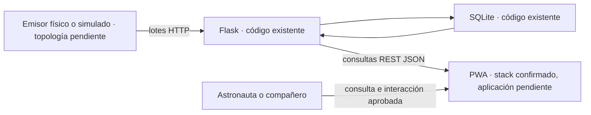

# Arquitectura compartida

La frontera **CONFIRMADA** es sensores o simulación → backend central → JSON → frontend. El diagrama representa las responsabilidades y el estado de cada parte. Describe un flujo lógico, con despliegue físico pendiente.

## Recorrido de una medición

| Paso | Responsabilidad y evidencia | Dependencia para entregar |
| --- | --- | --- |
| 1. Adquirir | Sensores o simulación producen una variable, un valor y una hora. La primera propuesta, pp. 1–2, plantea Raspberry Pi por astronauta con almacenamiento local y cola durable. | Confirmar emisor, catálogo, escala, reloj y comportamiento de reenvío con el subequipo. |
| 2. Ingresar | IMPLEMENTADO en [readings.py](../Backend/routes/readings.py). Flask recibe lotes HTTP, valida y procesa muestras aceptadas. La clave de idempotencia es astronauta, hora y variable. | Suministro de datos y credencial del emisor. Confirmar qué casos de aceptación parcial verificará simulación. |
| 3. Persistir y procesar | IMPLEMENTADO en [schema.sql](../Backend/schema.sql) y [rules.py](../Backend/rules.py). SQLite con WAL, registros de nodo, telemetría, alertas, notas, línea base y credenciales. El motor aplica reglas existentes y guarda alertas. | Revisar qué resultados pueden mostrarse y cómo se etiqueta su procedencia. |
| 4. Exponer | IMPLEMENTADO en [las rutas](../Backend/routes/) como consultas REST de tripulación, estado, histórico y alertas. Notas y reconocimiento tienen rutas propias. | Confirmar revisión, acceso desde navegador y ejemplos de datos con Mauricio. |
| 5. Presentar | CONFIRMADO el stack React, Vite, TypeScript y Material UI. PROPUESTO separar adaptación de JSON, estado de consulta, presentación y shell PWA. | Crear aplicación bajo autorización posterior, definir procedencia, frescura y alcance de demo. |

## Arquitectura de referencia y estado real

El diseño original mantendría adquisición y sincronización en un nodo Raspberry Pi y deja HTTP/MQTT como opciones. La descripción del backend usa ESP32 o simulador como emisor y Raspberry Pi como posible cliente de cabina. El código del repositorio materializa la recepción HTTP central y sus consultas, con Flask y SQLite. El backend usa validación propia. FastAPI, Pydantic y PostgreSQL figuran como alternativas en la propuesta definitiva §6.2. El contrato de referencia está en [API.md](../Backend/docs/API.md).

La topología de demo sigue abierta. La PWA podría conectarse a una API local en el mismo equipo o a un equipo alcanzable por red. Las escrituras de notas y acuses existen en el servidor. Eventos de asistencia, colas offline del navegador y SSE/WebSocket requieren decisión y diseño. La [guía de integración](INTEGRATION_GUIDELINES.md) define cómo cerrar estas fronteras.

## Conectividad y degradación

| Escenario | Evidencia disponible | Comportamiento esperado de la PWA |
| --- | --- | --- |
| API accesible y lectura reciente | La API responde y el nodo reportó una muestra dentro del criterio acordado. | Mostrar valor, hora, calidad y unidad. |
| Emisor desconectado | El servidor puede seguir respondiendo. El estado del nodo se infiere por último contacto. | Mostrar nodo sin contacto reciente y hora de la última muestra disponible. |
| Reenvío y recuperación | El contacto puede actualizarse al llegar un lote antiguo. Ingesta y cola del emisor son capacidades distintas. | Reconsultar según la política aprobada y evaluar frescura por muestra, incluso con nodo online. |
| Dato obsoleto o ausente | Fecha de medición fuera del criterio o colección vacía. | Identificar antigüedad o ausencia. Los datos ausentes permanecen vacíos. |
| Sensor degradado o averiado | La calidad es un atributo de cada lectura. La conectividad mide otra cosa. | Identificar el estado del sensor y evitar representar la muestra como plenamente utilizable. |
| API inaccesible | Fallo de consulta, timeout o error de servicio. | Mostrar estado de servicio y recuperación según la política aprobada. Identificar la hora de la última lectura disponible. |

Un nodo puede adquirir sin enlace si su implementación lo permite. Una API disponible en LAN puede seguir funcionando sin Internet. Una PWA con caché de shell podría abrir sin la API. La instalación, caché, persistencia y sincronización del navegador quedan PENDIENTES DE VALIDACIÓN. Propuesta inicial §§1–2 y propuesta definitiva §§6, 15–16.

## Seguridad y propiedad

El emisor y el proveedor administran la ingesta. Mauricio mantiene autenticación y documentación REST. El líder frontend coordina el acceso del navegador y valida las respuestas antes de presentar sus datos. Se usarán datos ficticios en la demo. La PWA debe evitar credenciales privadas en sus recursos públicos y respetar la revisión de [contenido médico](MEDICAL_CONTENT_POLICY.md). El origen, HTTPS o localhost, credenciales y persistencia local se cierran en [decisiones](DECISIONS.md).
